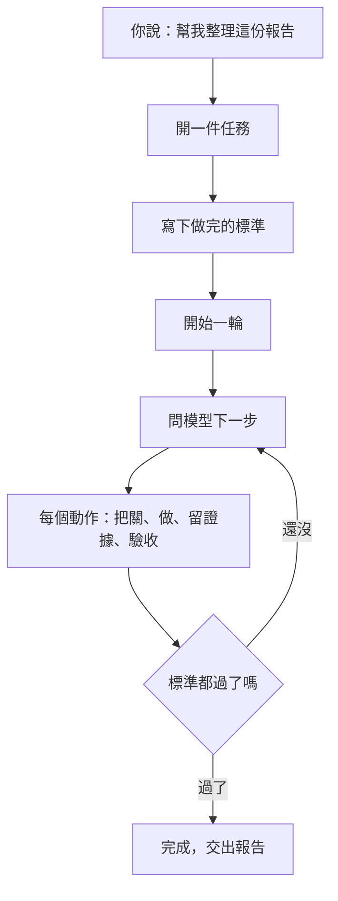
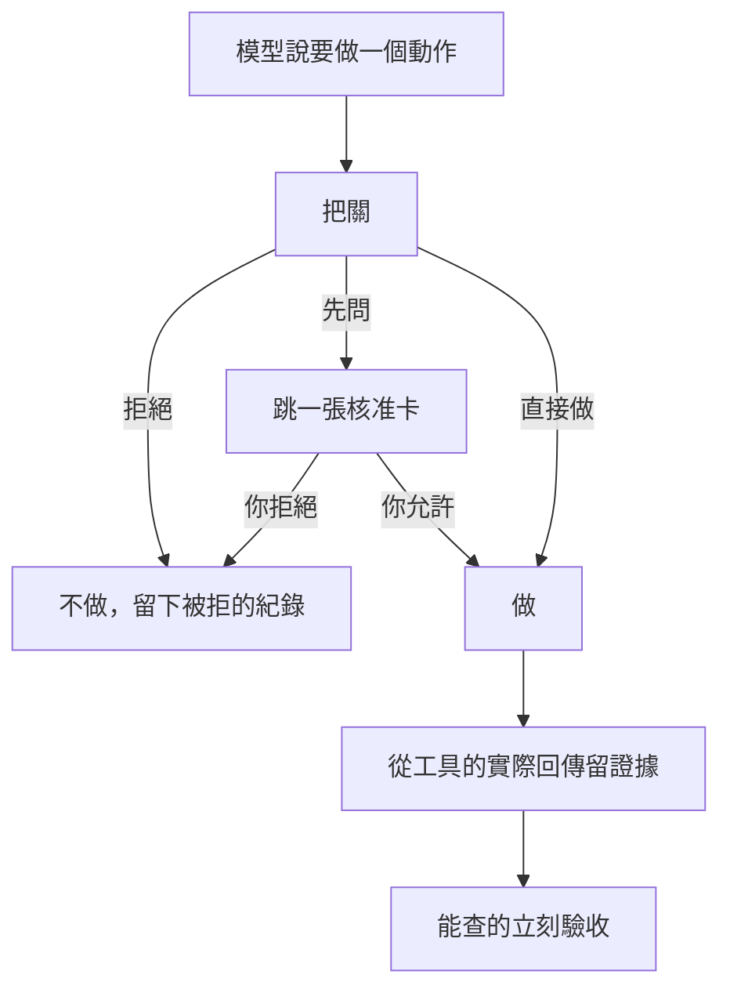
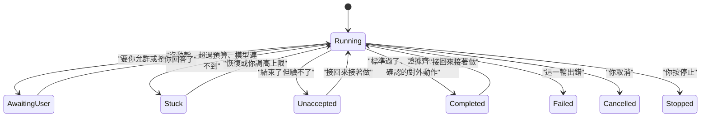

這一頁講你說一句話之後，中間發生什麼。適合想知道「它怎麼把事情做完」的人。

對你的意義：你說「幫我整理這份報告」，然後可以去做別的。它自己做、自己查、做完才叫你。

下面用這句話當例子。**這整條路現在還沒接上。**規則有一部分能用程式算（🚧），聊天、執行、畫面都還沒做（📝）。

## 從一句話到一件任務

任務不是一段聊天。聊天是任務的對話。一件任務有目標、做完的標準、狀態、下次跟進、證據、交付報告。

你送一句話，而這個 Bot 沒在做你起的那一輪，就開一件新任務。你在它做的時候再補一句，算同一件，不開新的。

例行任務到點、別的 Bot 交辦、頻道來的一則，各開一件。追進度的叫醒不開新的，接回原本那件。

這張圖在講：一句話怎麼變成一件任務，然後進入一輪。

開任務的「每一輪剛好屬於一件」已有單元測試（🚧）。真的從聊天開任務是 📝。

## 一輪怎麼跑

一輪就是它連續做一段，直到要問你、做完、或卡住。

1. 從任務狀態、原文紀錄、記憶，組出這一次要給模型看的內容。怎麼組見[[記憶與上下文]]。
2. 問模型。模型說要做哪個動作。
3. 每個動作走「把關 → 做 → 留證據 → 驗收」。
4. 把結果送回模型，再問下一步。
5. 這一輪結束時，系統自己看完成條件。沒過就接著做。過了才算完成。

你在它做的時候插話，下一步就讀到。那一輪不是你起的（例如例行任務），你的話不混進去，等它做完再回你。

執行迴圈是 📝。

## 每個動作的四步

這張圖在講：一個動作要先過關，才做；做完留下證據，能查的立刻查。

例子：整理報告時，它要改你電腦上的一個檔。

- 把關：這是改檔，預設先問。你如果早就允許過「改這個資料夾裡的檔」，就直接做。
- 做：真的寫進檔案。
- 留證據：記下改了哪個檔、改之前和改之後的指紋。模型不能自己寫「我改好了」來充證據。
- 驗收：重讀那個檔，指紋要跟寫進去的一樣。

這四步的產品流程是 📝。把關「哪一層說了算」的規則已有單元測試，見[[信任與安全]]。

## 八種狀態

一件任務任何時刻剛好一種主狀態。狀態由事件算出來，不聽模型說「我完成了」。

這張圖在講：狀態怎麼變。完成只有一條窄路。

| 主狀態 | 你看到的意思 |
|---|---|
| 進行中 | 正在做，或在排隊、在追進度 |
| 等你 | 有一張卡、一個問題，或中斷後要你按繼續 |
| 卡住 | 十五分鐘沒動靜、超過預算、模型連不到、上下文放不下 |
| 完成 | 標準過了。細項可以是已回覆、已驗收、已交付、你已確認 |
| 未驗收 | 結束了，但系統沒辦法證明。只是標記，不要你做事 |
| 失敗 | 出錯，或目標做不到 |
| 已取消 | 你明確取消。不算失敗 |
| 已停止 | 你按了停止。不算失敗 |

完成的細項只往前走：已驗收，再到已交付，再到你已確認。按掉讚不會退回去。

這些狀態的轉移規則已有單元測試（🚧）。畫面上還看不到任務（📝）。

## 怎樣才算完成

四條都要成立，而且都由系統判斷。你不用按「我確認它做完了」。

1. 做完的標準都通過。
2. 標成已驗證的宣稱，都有涵蓋它的驗收紀錄。
3. 沒有「結果不知道」的對外動作。
4. 不是因為超過預算而停下的。

少了怎麼辦：

| 少了什麼 | 變成 |
|---|---|
| 還有一項沒過 | 繼續做 |
| 有一步對外動作結果不知道 | 等你按繼續 |
| 超過預算 | 卡住，交出做到哪 |
| 驗不了 | 未驗收，不推播 |

做完的標準一旦定下，Bot 不能自己放寬。它可以加更嚴的項目，不用問你。想放寬的提議放進報告，你同意才改。

只有聊天、沒有動手：回覆送到了，就是完成（已回覆）。

這四條已有單元測試（🚧）。真的去重讀檔案、重跑測試，是 📝。

## 預算

每件任務有上限：工具呼叫次數、輪數、時間、token、花費、同一步重試次數。沒設的項目就不限。預設數字之後實測再定。

超過任何一項，正在跑的那一步做完，不開新的一步。任務變成卡住，寫出是哪一項。你調高上限後可以接著做，用量不歸零。

換模型、中斷後接著做，用量都不歸零。

預算的計算已有單元測試（🚧）。

## 中斷後怎麼接著做

做事的那台在一輪中間關掉：

- 只是在看的步驟（讀檔、截圖）：下次打開，自動接著做。
- 可能已經改到外面的步驟（寫檔、寄信、跑指令）：不自己重做。任務變成等你，請你按繼續。
- 你按過停止的那一輪，不會被接回來。

當機前，每個對外步驟都先寫進這台的本機資料庫，再做。斷電時寫到一半的那筆跳過。

「結果不知道時，不可逆的動作絕不自己重做」已有單元測試（🚧）。當機後真的接回來，是 📝。

## 想看細節

- 任務物件、八種狀態、完成閘門、事件、預算、中斷：[spec/10-behavior/1-followup.md](https://github.com/igs170911/AnyBot/blob/main/spec/10-behavior/1-followup.md) 的 `task-object`、`task-state`、`task-done-gate`、`task-events`、`task-budget`、`task-effects`、`task-resume`
- 完成和少介入：`spec/09-decisions.md` 的 K100
- 狀態由事件算出、預算、換模型：K104
- 任務是一級物件：[spec/04-product-core.md](https://github.com/igs170911/AnyBot/blob/main/spec/04-product-core.md) §3
