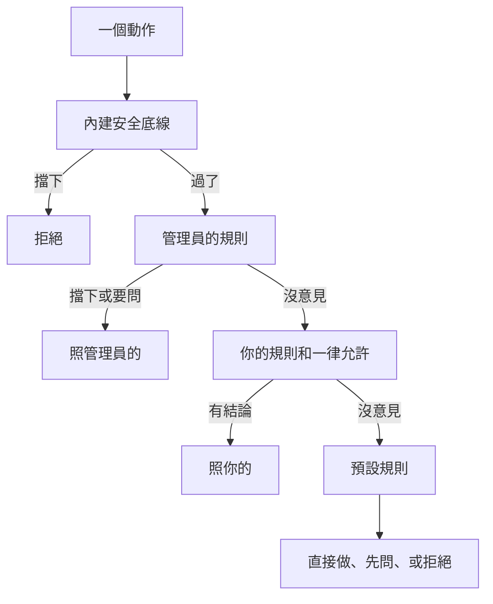

這一頁講什麼動作會先問你、什麼誰都關不掉、你怎麼知道哪句話可以信。適合把事情交給它之前想先看安全規則的人。

對你的意義：刪除、寄信、發佈、付款這類事，預設一定先問。你明確允許過的那一種具體動作，才不再問。底線誰都關不掉。

規則有一部分已經寫成程式、有單元測試（🚧）。真的跳出核准卡、留證據、產生報告，還沒做（📝）。

## 核准的關卡順序

每一步由跑這一輪的那台照規則決定：直接做、先問、或拒絕。上面一層說拒絕或要問，下面一層放不掉。同一層裡，先看拒絕，再看要問，最後才看允許。

這張圖在講：一層層過關，第一個有結論的就停。

| 順序 | 誰的規則 | 例子 |
|---|---|---|
| 1 | 內建底線 | 危險指令、私密檔。誰都關不掉 |
| 2 | 管理員 | 鎖住「在這台執行」、管理員的檢查程式 |
| 3 | 你 | 一律允許、這段對話都允許、你自己的規則 |
| 4 | 預設 | 六類先問，唯讀的多半直接做 |

「高的一層說了算」已有性質測試（🚧）。真的一步步問你，是 📝。

## 誰都關不掉的底線

就算你打開「一律放行」，下面這些還是成立：

1. 危險指令拒絕。
2. 私密檔不能讀、不能改、不能傳出去。
3. Bot 不能點 AnyBot 自己的視窗和核准按鈕。
4. 雲端中繼資料位址、Docker 管理位址打不開。
5. 沒有指令沙盒的電腦（Windows）上，跑指令每次都問，沒有「一律允許」。
6. 只有人能答的卡（問題、需要你處理、計畫），任何模式都不代答。
7. 頻道或團隊成員發起的那一輪，不用你以前的自動放行。
8. 回答只落在你按下時看到的那張卡。聊天頻道不能按允許。
9. AnyBot 自己的金鑰不進 Bot 跑指令的地方。

前四條在各種設定組合下都會拒絕，已有性質測試（🚧）。畫面上列出這九條，是 📝。

## 一定先問的六類

程式認出這六類，預設先問你。模型不能說「這次不用問」就跳過。

| 類 | 例子 |
|---|---|
| 刪除 | `rm`、刪一條例行任務、畫面上的「刪除」 |
| 寄給別人 | 寄信、傳訊息 |
| 分享 | 把 Bot、頁面、檔案分享給別人 |
| 發佈 | `git push`、在網站上送出文字、貼文 |
| 付款 | 結帳、轉帳、用保險庫填卡片 |
| 改密碼 | 網站上的改密碼，直接交給你做 |

你按過「一律允許：在 Slack 的 #team 發訊息」，之後這個具體動作不再問。別的頻道、別的刪除，照問。

一律允許蓋得過預設的「先問」，蓋不過底線和管理員。

六類怎麼認，已有單元測試（🚧）。核准卡的畫面是 📝。

回答有四種：允許這次、這段對話都允許、一律允許、拒絕。一張卡只能被答一次。答案由伺服器裁判，不採用畫面上自己傳來的字。

沒人在旁邊等核准，十五分鐘後這一輪先收工。任務停在「等你」，並推播。你回來答了再接著做，不算失敗。這條是 📝。

## 把關到驗收

放行之後才做。做完，程式從工具的實際回傳寫證據。模型沒有「寫一筆證據」的工具。它在回覆裡打「證據：已送出」，不會變成證據。

能查的立刻查：改過的檔重讀一次，寄出的信要有信件編號，指令要有結束碼。

外部 agent 如果有的動作來不及在做之前把關，那筆標「未經把關」。跟它有關的宣稱不能是已驗證。

這條產品流程是 📝。

## 證據和宣稱的等級

交付報告和記憶裡的每句宣稱，由程式分等級。模型不能自己標。

| 等級 | 意思 | 例子 |
|---|---|---|
| 已驗證 | 在寫明的範圍內驗過 | 重讀檔案，指紋相符，範圍是「Bot 的電腦」 |
| 有來源支持 | 有證據，還沒驗收 | 工具回了實際結果，或你親口說的 |
| 推論 | 模型推出來的，或別的 Bot 轉述 | 「B 說已經寄了」 |
| 不知道 | 沒有任何來源 | 它說寄了，沒有寄信紀錄 |

記憶另外有過時、有矛盾。

同一個模型重複說、或好幾個模型附和，都不算驗證。只連到「未經把關」的證據，最高到有來源支持。

報告同時寫明沒驗到的範圍。例如只在 Bot 的電腦上驗過，你的筆電上沒驗。

這四個等級的計算已有單元測試（🚧）。報告畫面是 📝。

判斷來源另外標：規則、程式檢查、或模型判斷。你一眼就知道這句是怎麼來的。

## 資料會送到哪裡

每個 Bot 有一份資料政策，說對話、檔案內容、截圖、記憶可以送到哪。

- 只用本機或區網模型的 Bot，預設不送雲端。一個位元組都不送。
- 你自己要把雲端備用模型加進去時，畫面先問。你同意，才把那家加進政策。
- 語意摘要、記憶的向量，只用本機或區網的模型。不叫雲端模型壓縮你的對話。

金鑰加密存在伺服器，同步到各台的系統鑰匙圈。執行端直接呼叫模型。Bot 跑指令的環境拿不到這些金鑰。

你交給 Bot 用的密鑰（例如一個網站的登入）跟 AnyBot 自己的金鑰分開。只在跑那一步時放進去，輸出裡出現就遮掉，每次使用留紀錄。

資料政策的產品行為是 📝。金鑰印出來會變成 `Secret(masked)`，這個型別已做好（✅）。金鑰怎麼存進鑰匙圈、怎麼同步，還沒做。

開放別人註冊的伺服器，註冊畫面要寫清楚：伺服器的管理者看得到你的對話。端對端加密是之後的事。

## 想看細節

- 把關、底線、六類、宣稱等級：[spec/10-behavior/2-trust.md](https://github.com/igs170911/AnyBot/blob/main/spec/10-behavior/2-trust.md) 的 `trust-pipeline`、`trust-floor`、`safety-gates`、`safety-n5`、`claim-levels`
- 安全承諾：[spec/00-boundaries.md](https://github.com/igs170911/AnyBot/blob/main/spec/00-boundaries.md)「安全承諾」
- 權限順序、六類、十五分鐘：`spec/09-decisions.md` 的 K26、K29、K30
- 宣稱等級、資料送到哪：K101、K102
- 核准在執行端：[spec/02-architecture.md](https://github.com/igs170911/AnyBot/blob/main/spec/02-architecture.md) §5.3
