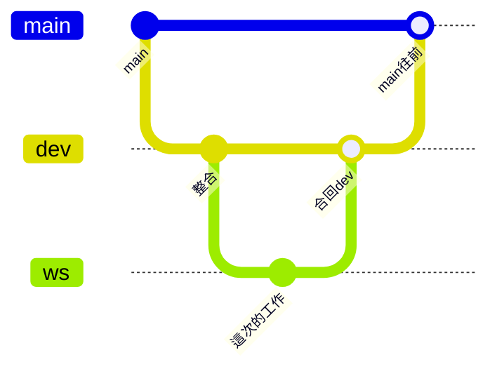
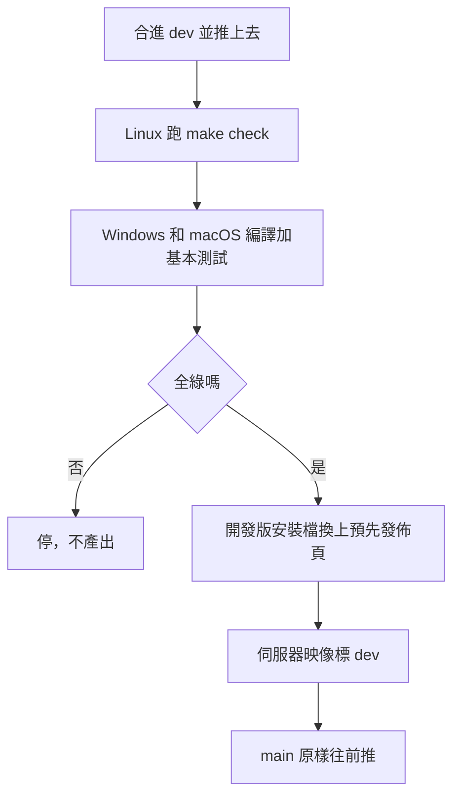

這一頁講分支怎麼走、推上去之後自動做什麼、一個版本怎麼發。適合要參與開發的人。假設你會基本的 git。

對你的意義：`main` 永遠是檢查全綠的。日常開發合進 `dev`。正式版要有人明確說了才發。

自動檢查和自動產出安裝檔都還沒接到 GitHub（📝）。下面寫的是已定的流程，不是現在已經會自動發生的事。

## 三條分支

| 分支 | 是什麼 | 誰可以改 |
|---|---|---|
| `main` | 主要分支。永遠是檢查全綠的 | 不能直接改。`dev` 全綠後，原樣往前推到那個 commit |
| `dev` | 整合用。從 `main` 切出來 | 工作分支做完合回來。外面的人的 PR 只對 `dev` |
| `ws/<名稱>` | 一個工作分支。從 `dev` 切出來 | 做這件事的人。做完合回 `dev` |

這張圖在講：工作分支合回 `dev`，`dev` 全綠後 `main` 跟著往前。

合進 `dev` 不另外改內容。`main` 往前也不產生新的 commit，就是同一個。

GitHub 上 `main` 要有保護規則：只收檢查全綠的 commit，不能直接改，不能強制覆蓋。這個保護規則還沒設（📝）。

agent 不准 push。推上去由使用者或監督者做。

## 推上去之後自動做什麼

這張圖在講：合進 `dev` 之後的檢查和產出。產出那一段還沒做。

| 什麼時候 | 自動檢查 | 自動產出 | 狀態 |
|---|---|---|---|
| 推任何分支、任何 PR | Linux 跑 `make check` | 無 | 📝 工作流程檔還沒進 repo |
| 合進 `dev` 並推上去 | Linux 全部關卡；Windows、macOS 編譯加基本測試 | 全綠後換上開發版 | 📝 後段是 REL-1 |
| `dev` 全綠 | — | `main` 往前推到同一個 commit | 📝 |
| `main` 上打 `v*` | 三種系統編譯 | GitHub Release 草稿，加上伺服器映像 | 📝 |
| 每週 | 相依套件的安全公告，並掃金鑰 | 無 | 📝 |

現在 repo 裡有一份舊的 Gitea 工作流程（`.gitea/workflows/ci.yml`）。它沒有在 GitHub 上跑過。K110 要把它改成 `.github/workflows/`。那份改動還沒合進來。

開發版用不同的 App 名稱和資料夾，跟正式版並存。舊的開發版安裝檔自動換掉。

外面的人的 PR 只對 `dev`，跑全部檢查，拿不到任何金鑰。

工作流程的安全規則要用工具擋：權限給最小、第三方 action 釘在完整的 commit 雜湊、下載的工具固定版本並驗雜湊、每個工作有時間上限。

## 怎麼發一個版本

1. `dev` 全綠，`main` 已經停在那個 commit。
2. 使用者說要發。打版本標籤要使用者說，監督者不能自己打。
3. 標籤要在 `main` 上，那個 commit 全綠，標籤跟版本號一致。
4. 自動在 Linux、Windows、macOS 編譯桌面 App 和伺服器。
5. 先出 Release 草稿。檢查後才公開。
6. 安裝檔掛在 Release。伺服器映像推到容器倉庫。
7. `-rc.N` 這類標籤標成預先發佈，不是正式版。

先不簽章。安裝時系統會跳警告，Release 說明要寫怎麼放行。見[[安裝與使用]]。

簽章過的安裝檔是目標（`06` S12），還沒做到。

## 想看細節

- CI 在 GitHub、先不簽章：`spec/09-decisions.md` 的 K110
- 分支和誰可以推：K111
- 發佈是目標：[spec/06-tech-stack.md](https://github.com/igs170911/AnyBot/blob/main/spec/06-tech-stack.md) S12
- 路線裡的 CI-1、REL-1：[docs/plan.md](https://github.com/igs170911/AnyBot/blob/main/docs/plan.md)
