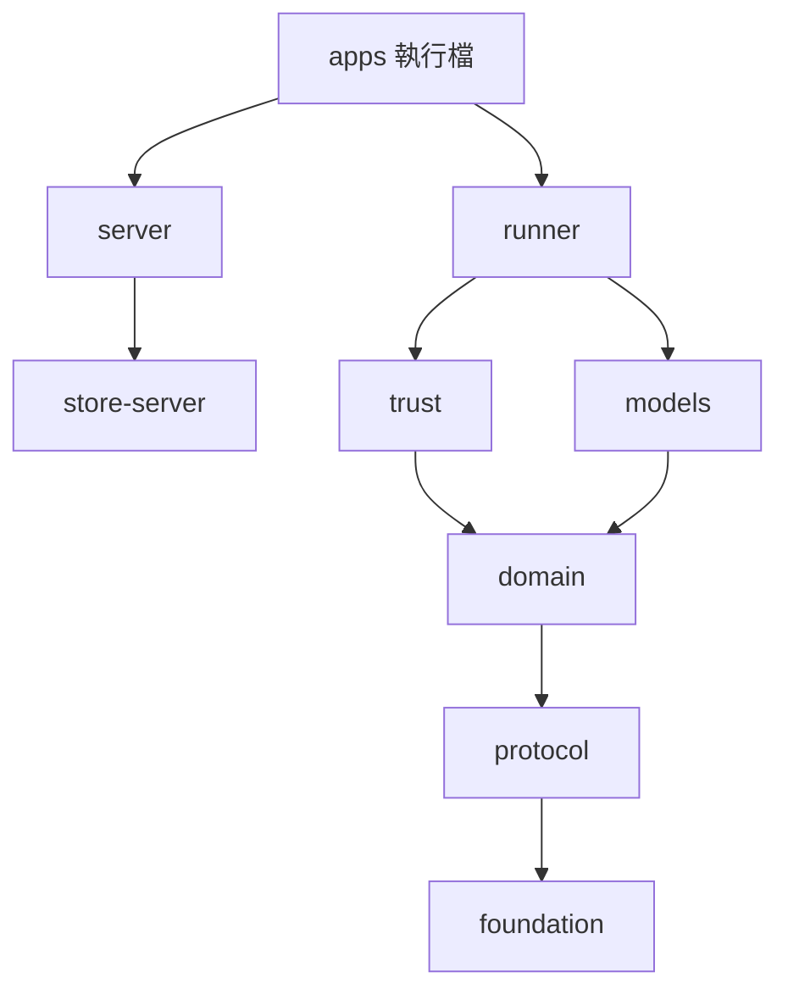

這一頁是 repo 的資料夾導覽。適合要找「程式放在哪」的人。假設你會基本的命令列。

對你的意義：規格、程式、畫面、測試分開。上層可以用下層，下層不能回頭依賴上層。這件事有工具在擋。

## 資料夾

| 資料夾 | 放什麼 |
|---|---|
| `spec/` | 唯一的需求來源。任何人都不准改，除非規格本身要更新 |
| `docs/` | 給人和維運的文件。這份 wiki 的原稿在 `docs/wiki/` |
| `docs/tasks/` | 每個里程碑的任務檔 |
| `crates/` | Rust 函式庫。一層一個套件 |
| `apps/` | 可以執行的東西：伺服器、執行服務、背景程式、命令列、桌面、網頁 |
| `web/` | 桌面和手機共用的 TypeScript：畫面元件、API 客戶端 |
| `locales/` | 翻譯檔。英文是基準，繁體中文要齊 |
| `api/` | OpenAPI 和執行事件的 AsyncAPI。由程式產生，提交進 repo |
| `migrations/` | 資料庫遷移。伺服器 PostgreSQL，客戶端 SQLite |
| `tests/` | 跨套件的測試、假服務、端對端、測試用資料 |
| `tools/` | 自家的檢查工具：依賴方向、規格覆蓋、鐵律、翻譯、API 文件 |
| `adapters/` | 非 Rust 的轉接器。Claude Code 的那側之後放這裡 |
| `images/`、`deploy/` | 伺服器映像在 `images/server/Dockerfile`。發佈腳本在 `deploy/release/`。compose 和 Helm 之後再加 |

授權是 `MIT OR Apache-2.0`。根目錄有兩份授權全文。

## 可執行的程式

| 路徑 | 程式 | 現在 |
|---|---|---|
| `apps/server` | `anybot-server` | 🚧 能啟動、能回答健康檢查 |
| `apps/runner-service` | 伺服器上的執行服務 | 📝 空殼，印版本 |
| `apps/agent` | 你電腦上的背景程式 | 📝 空殼，印版本 |
| `apps/cli` | `anybot` | 📝 空殼，印版本 |
| `apps/desktop` | 桌面視窗（Tauri 2） | 🚧 一扇窗，沒有頁面 |
| `apps/web` | 手機和瀏覽器用的網頁 | 🚧 同一套空殼 |

視窗只是畫面。做事的是背景程式 `apps/agent`。所以桌面殼不准依賴伺服器、模型、工具、電腦。這條由 depcheck 擋。

## 誰可以依賴誰

上層可以用下層，反過來不行。伺服器的 API 套件不准依賴執行端、模型、工具、電腦。這樣用套件依賴就擋住「伺服器自己不跑腦」。

這張圖在講：依賴只往下，不回頭。

| 套件 | 只准依賴 | 特別禁止 |
|---|---|---|
| `foundation` | 無 | 最底層：編號、時間、錯誤、金鑰型別、啟動檔 |
| `messages` | 無 | 只做「代碼＋語言 → 字」 |
| `protocol` | foundation | 事件和 API 型別 |
| `domain` | foundation、protocol | 不准碰網路、檔案、資料庫、非同步 |
| `trust` | foundation、protocol、domain | |
| `models`、`tools`、`computers`、`mcp` | foundation、protocol、domain | 彼此不互相依賴 |
| `server` | foundation、protocol、domain、store-server、blob、bus、channels | 不准依賴 runner、models、tools、computers |
| `runner` | 上面幾乎全部 | 不准依賴 store-server、server。它是 API 的客戶端 |

執行服務和你電腦上的背景程式，都透過伺服器的 API 寫紀錄，不直接連資料庫。

有些寫法只准在指定套件：發 HTTP 只准在模型、同步、頻道、電腦、MCP。執行外部程式只准在電腦，而且要經過信任層給的通行證。讀環境變數做新版自己的設定，任何地方都不准。只有遷移工具在搬舊資料時，可以讀舊版用過的環境變數。

根目錄 `tests/` 的測試輔助套件可以執行程式、連網路、寫 `target/`。產品套件只能把它當開發用依賴。

## 想看細節

- 資料夾和依賴表：[spec/07-repo-layout.md](https://github.com/igs170911/AnyBot/blob/main/spec/07-repo-layout.md) §2、§3
- 技術選型：[spec/06-tech-stack.md](https://github.com/igs170911/AnyBot/blob/main/spec/06-tech-stack.md) §2
- 遷移才可以讀舊環境變數：`spec/09-decisions.md` 的 K89
