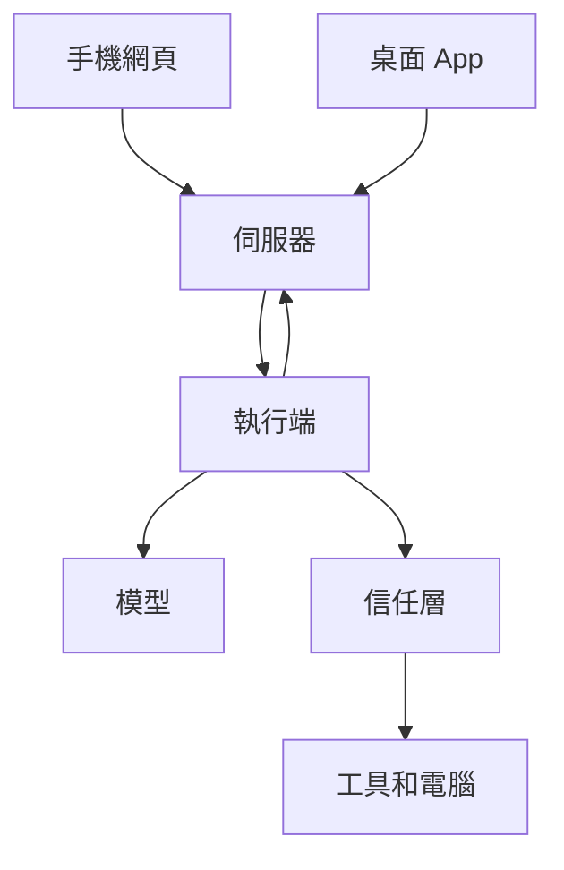
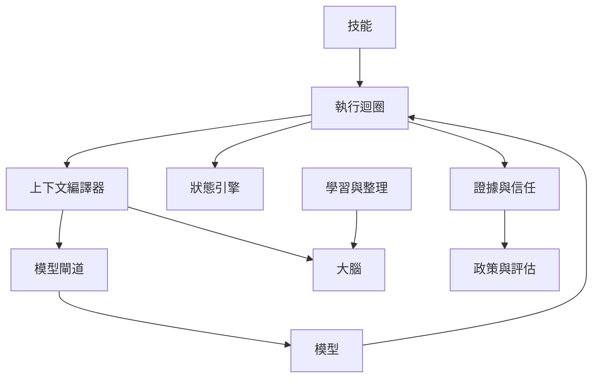
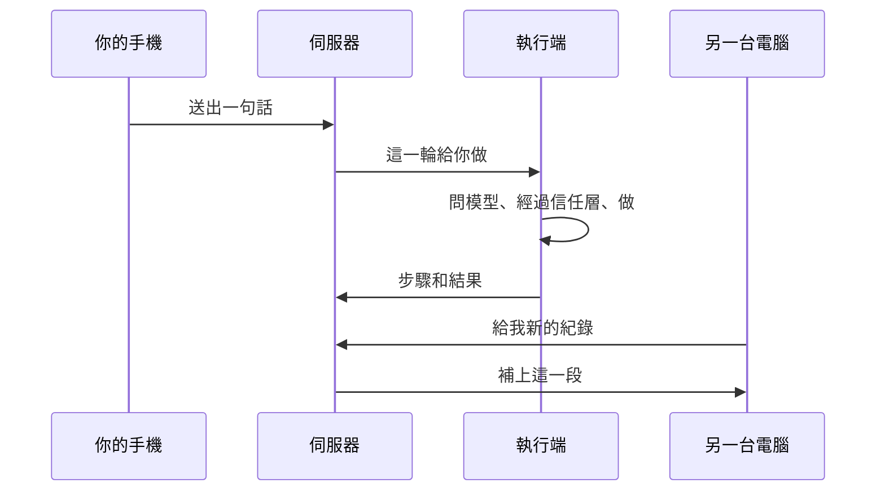

這一頁講 AnyBot 有哪些角色、各做什麼。適合想知道「我的資料和事情在哪裡發生」的人。

對你的意義：你不用管現在在哪台做。你看到的是一直可以聊天，結果會同步過來。

下面是規格定好的形狀。角色的程式大多還是空殼，狀態寫在每一節。

## 一句話

腦跟著做事的那台走。每台裝置留一份本機副本。伺服器負責帳號、排隊、轉送和協調。伺服器自己不問模型。

這張圖在講：你的手機和電腦都連到伺服器，做事的腦在執行端，不在伺服器的 API 裡。

## 有哪些角色

| 角色 | 做什麼 | 不做什麼 | 狀態 |
|---|---|---|---|
| 伺服器 | 帳號、裝置、紀錄彙整、信箱、排程、推播、協調 | 不問模型、不跑工具、不保存進行中的回合 | 🚧 能啟動、能回答健康檢查。帳號、同步、信箱有人正在寫，還沒合進 `dev` |
| 執行端 | 問模型、跑工具、把關、把每一步寫回伺服器 | — | 📝 執行檔是空殼，會印版本 |
| 使用者的電腦 | 桌面畫面，加上這台的執行端和手腳 | 視窗本身不做事 | 🚧 視窗打得開，裡面沒有頁面 |
| Bot 的電腦 | 每個使用者一台共用的 Docker。Bot 在這裡跑指令、讀寫檔、開瀏覽器 | 沒有任何金鑰。不同使用者不共用 | 📝 |
| 手機 | 送指令、看紀錄、按允許 | 不跑腦。一律連伺服器，不直接連桌面 | 🚧 網頁打得開，沒有頁面 |
| 聊天頻道 | Slack、Discord、Telegram：聊天、看進度 | 不能按允許。頻道來的話不受信任 | 📝 |

桌面（Mac、Windows、Linux）和手機講同一套：對話、工具、核准。手機是網頁，可以加到主畫面，不做原生 App。

沒有遠端伺服器時，伺服器和 Bot 的電腦要在你自己的電腦裡跑，由桌面 App 裝好。這台裝不起 Docker 時，先讓它能聊天、能在本機做事，並說清楚手機和例行任務要等伺服器。這條是 📝。

## 分層

由上往下。上面用下面，下面不用知道上面。換掉某一層，上面不用改。

| 層 | 是什麼 |
|---|---|
| 工作區 | 桌面 App、手機網頁：聊天、任務、交付報告、核准 |
| Bot | 執行端，或接進來的外部 agent（例如 Claude Code） |
| 信任層 | 夾在 Bot 和工具中間：把關、做、留證據、驗收 |
| 模型 | 各家模型供應商 |
| 工具 | 內建工具，加上 MCP 接進來的工具 |
| 執行環境 | Bot 的電腦，或你自己的電腦（有沙盒） |
| 基礎設施 | 你的電腦、自架伺服器、雲 |

三個可以替換的介面：Bot、電腦、工具。每種都有預設做法，以後可以換成別的。不管哪一種工具，都經過信任層。

## 一個 Bot 裡的九個模組

這九塊合起來是**一個** Bot，不是九個 Bot。換模型不換 Bot 的身分。

這張圖在講：一輪裡這九塊怎麼接力。現在只有狀態引擎和信任的規則有程式，其他還在規劃。

| 模組 | 做什麼 | 狀態 |
|---|---|---|
| 執行迴圈 | 一輪怎麼跑：問、做、再問 | 📝 |
| 上下文編譯器 | 每次問模型前，從原文組出這一次要看的內容 | 📝 |
| 模型閘道 | 把各家的格式整理成同一種，處理錯誤和換模型 | 🚧 有人正在寫，還沒合進 `dev` |
| 狀態引擎 | 從事件算出任務現在是什麼狀態 | 🚧 純規則已有測試，還沒接到伺服器 |
| 大腦 | 記憶怎麼存、怎麼搜 | 📝 |
| 證據與信任 | 把關、留證據、驗收、宣稱分級 | 🚧 把關和分級的規則已有測試 |
| 技能 | 先當候選，通過測試才上線 | 📝 |
| 學習與整理 | 從成功和失敗整理教訓，有自己的預算 | 📝 |
| 政策與評估 | 資料可以送到哪、能力用實際數字算 | 📝 資料政策的規格已定 |

## 資料怎麼流動

你說的話先記在這台，再送到伺服器。伺服器只排順序。做事的那台問模型、跑工具，再把步驟送回去。其他裝置跟伺服器要「我上次看到之後的」。

這張圖在講：一句話從你的手機，到做事，再到另一台看得到。

連線只是讓更新快一點。斷線不會掉資料。動作用一般的 HTTP，失敗就重送，不會做兩次。變化用一條帶編號的即時流，重連時從上次的編號補。

| 資料 | 衝突時怎麼辦 | 狀態 |
|---|---|---|
| 對話、記憶、任務進度 | 只往後加，合起來就是全部 | 📝 合併規則有一部分單元測試 |
| 設定、核准規則 | 以欄位為單位，後寫的贏 | 🚧 合併規則已有單元測試 |
| 這一輪誰跑、核准卡的答案 | 伺服器當裁判，不能有兩份 | 📝 |
| 電腦上的檔案 | 留在做事的那台，點開才去拿 | 📝 |
| 金鑰 | 加密存在伺服器，同步到各台的系統鑰匙圈 | 🚧 專用型別已做好，不會被印出來。存進鑰匙圈、同步還沒做 |

檔案、瀏覽器登入、紀錄檔、當機報告不同步。

## 這一輪在哪跑

| 你從哪裡叫 | 在哪跑 |
|---|---|
| 在電腦 A 上叫 | 電腦 A |
| 在手機上叫 | Bot 的電腦 |
| 例行任務 | Bot 的電腦 |
| 你指定了某台 | 那台。不在線就改派到 Bot 的電腦，並告訴你 |

一件任務同一時間只在一台跑。要用到另一台，就交辦一件新的子任務。預設不顯示在哪台跑。步驟詳情裡看得到。

這些改派規則是 📝。程式還沒做。

## 想看細節

- 角色、分層、同步、連線：[spec/02-architecture.md](https://github.com/igs170911/AnyBot/blob/main/spec/02-architecture.md) §0–§4、已定的決定 A1–A23
- 九個模組：`spec/09-decisions.md` 的 K93、K94
- 技術選型：[spec/06-tech-stack.md](https://github.com/igs170911/AnyBot/blob/main/spec/06-tech-stack.md) §2
