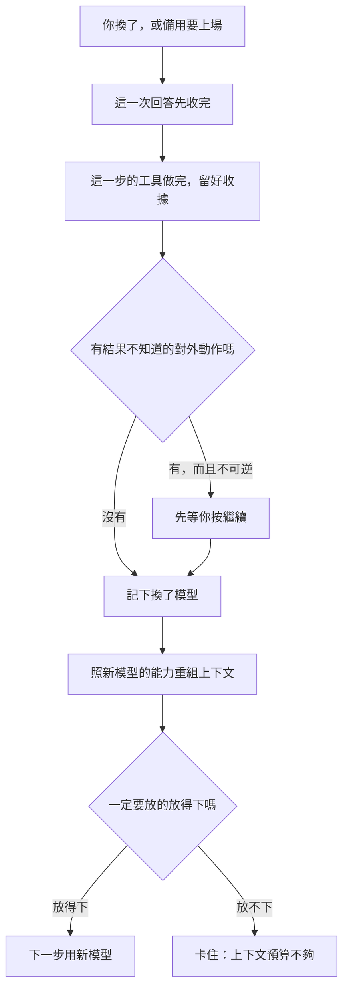

這一頁講可以接哪些模型、換模型時發生什麼、出錯怎麼辦。適合想知道「我的對話會不會被送到雲端」的人。

對你的意義：每個 Bot 用你自己的金鑰。只用本機模型時，對話不送雲端。換模型不換這個 Bot 的身分。

模型閘道的規格已寫好。程式還在別的工作分支，**還沒合進這一份**，所以這裡標 📝。不要把它當成已經能用。

## 可以接哪些

第一階段只用你自己的金鑰，或你自己的 ChatGPT 帳號。沒有營運方提供的共用金鑰。

| 供應商 | 格式 | 備註 |
|---|---|---|
| xAI Grok | OpenAI 相容 | |
| OpenAI | OpenAI 相容 | |
| Claude | Claude 自己的格式 | 一次最多輸出 64,000 token |
| Google Gemini | OpenAI 相容 | |
| OpenRouter | OpenAI 相容 | 請求帶 App 名稱 AnyBot，再轉給模型公司 |
| OpenCode Go | 每個模型各自 | |
| Ollama | OpenAI 相容 | 通常是本機或區網 |
| 自訂 | OpenAI 相容 | 你填網址 |
| ChatGPT 方案 | 用帳號登入，不用 API 金鑰 | 規格留著。這次的閘道工作不包含它 |

網址空的用那家的預設。結尾多餘的斜線拿掉。金鑰前後空白拿掉，用不會被印出來的型別裝，只送到那家設定的網址。

沒設金鑰時不連出去，直接告訴你去設定貼上。

## 本機、區網、雲端

照網址的字分類，不查 DNS。分不出來就當雲端。

| 分類 | 怎麼認 | 你看到的意思 |
|---|---|---|
| 本機 | localhost、127 開頭、::1 | 對話、檔案、截圖不離開跑這一輪的那台 |
| 區網 | 10 開頭、192.168、結尾 .local、.ts.net 這類 | 在你網路裡的那台 |
| 雲端 | 其他，以及 ChatGPT 方案 | 會送到那家的伺服器 |

本機或區網的 Bot，在連得到那個網址的電腦上跑。都連不到時，任務變成卡住（模型連不到），不偷偷換成雲端。那台上線後自動接著做。

## 資料只送到准許的地方

每個 Bot 有一份資料政策。

- 模型是本機或區網的：預設只送本機和區網。
- 模型是雲端的：預設也可以送雲端，只勾它自己那家。
- 你要把雲端備用加給只用本機的 Bot：畫面先問。同意才改政策。
- 目的地不在政策裡：不連出去。
- 網址回轉址：不跟著走。

驗收要「另一家模型」時，只在政策准許、而且金鑰已設好的裡面挑。沒有就用這個 Bot 自己那家。

語意摘要和記憶的向量，不管政策怎麼設，都只用本機或區網。

## 換模型

可以在任務做到一半換。不換 Bot 的記憶和聊天。一次回答從頭到尾是同一個模型寫的。

這張圖在講：換模型只發生在安全的步驟邊界。

換的時候：

- 記一筆事件：前後的模型、原因（你換的、Bot 換的、備用、連不到）。
- 預算不重算，用量不歸零。
- 舊模型的思考簽章只送回同一家、同一個模型。
- 你的原話、限制、做完的標準、目前步驟，照樣帶。

回答到一半失敗、改用備用時，沒寫完的工具呼叫不執行。從同一步用新模型接著做。

## 備用模型

一個 Bot 最多 8 個備用，照順序。

會換下一個的：額度用完、太忙、金鑰不能用、服務出錯、連不上。先重試，重試完才換。等不到第一個字，跟服務出錯一樣。

不換的：對話太長、不支援工具、模型名稱錯。沒金鑰的備用跳過。不在資料政策裡的備用也跳過。

不能用的休息 10 分鐘。這段時間新的一輪直接用備用，並寫出來。

## 錯誤怎麼處理

失敗分成一類，交給後面的是類別和訊息代碼，不是那家的原文。金鑰不出現在錯誤裡。

| 類別 | 重試 | 換備用 |
|---|---|---|
| 沒有金鑰、資料政策擋下 | 不連出去 | 跳過 |
| 金鑰或權限、額度用完 | 不重試 | 換 |
| 太忙、服務出錯、連不上、等不到第一個字 | 先重試 | 重試完才換 |
| 出字後卡住、對話太長、不支援工具、找不到 | 不重試 | 不換 |

有人在看：最多 3 次。沒人在看（例行任務、頻道）：最多 8 次。供應商說要等多久，照做，最多 30 秒。

畫面上已經出現文字、思考或工具，就不再重試。

各家的回應先整理成同一種：文字、思考、工具呼叫、用量、結束原因。有完整的工具呼叫，就算要用工具，不管那家寫的結束原因。串流沒正常結束，工具呼叫不交出去。

那家沒回用量，就記「沒有」，不填 0。

## 能力表

每個「供應商＋模型」有一張表：格式、可讀長度、最多輸出、能不能用工具、能不能串流、思考怎麼帶、能不能看圖、用哪個分詞器。

實際可用的長度，取能力表、你設的上限、用了才知道的上限，三個裡最小的。你沒設時，預設跟著能力表，不再寫死 128,000。

估算超過可用長度，就不送出，回「上下文預算不夠」。不截斷，也不讓那家自己截。

分詞器檔由呼叫的一方提供，不自動下載。沒有就用公式，再依實際用量校正。

## 想看細節

- 換模型、預算：`spec/09-decisions.md` 的 K104
- 資料送到哪：K102
- 閘道的取捨（換模型時機、備用、卡住、估算）：K109
- 供應商、錯誤、能力、交接、外送：[spec/10-behavior/6-integrations-models-settings.md](https://github.com/igs170911/AnyBot/blob/main/spec/10-behavior/6-integrations-models-settings.md) 的 `models-providers`、`models-errors`、`models-capabilities`、`models-handoff`、`models-egress`
