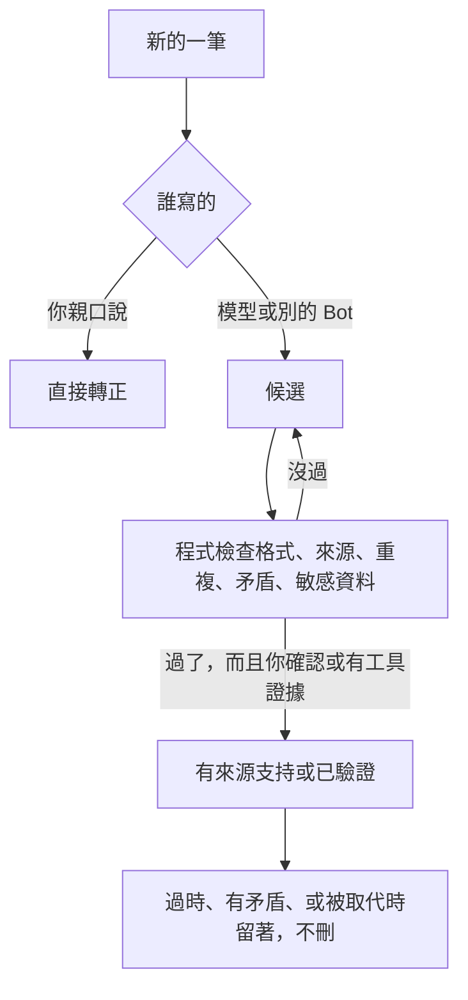
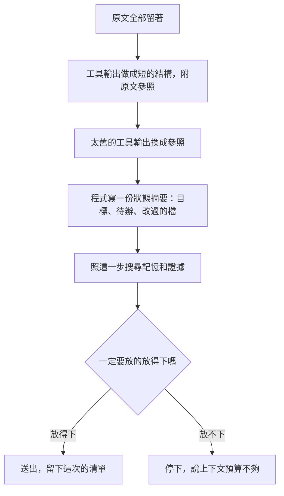

這一頁講 Bot 記得什麼，以及每次問模型前怎麼挑出要看的內容。適合想知道「它會不會把我的話越記越亂」的人。

對你的意義：原文一直留著。它不會把舊對話悄悄收成一段摘要，然後把你的原話弄丟。模型寫的記憶要先當候選，通過檢查才算數。

這一頁講的是規格。記憶和上下文編譯器都還沒做（📝）。

## 大腦記什麼

每筆記憶有編號、版本、種類、內容、來源、狀態。改了留歷史。合併時舊編號轉到新的，引用不會斷。

| 種類 | 例子 |
|---|---|
| 你的偏好 | 回覆用短句 |
| 知識 | 專案的報告放在某個資料夾 |
| 事件 | 上週寄過一封信 |
| 任務經驗 | 整理報告時要先給你看草稿 |
| 成功和失敗的教訓 | 上次沒重讀檔案，交出去才發現是舊的 |
| 做法 | 一項技能的索引 |

來源分這幾種：你說的、工具證據、模型推論、別的 Bot 轉述、匯入。

正本在伺服器資料庫。同時產生一個 Markdown 資料夾，Obsidian 打得開，但不依賴它。你在檔案裡改了，系統比對版本後匯回。有衝突讓你選。匯回前先檢查，不把檔案裡的字當成指令。

看大腦的頁面要做在 App 裡：記憶、技能、學到的東西、來源、關聯、版本差異、矛盾、過時、還沒驗證的候選。這個頁面是 📝。

## 記憶怎麼進來

你在聊天裡親口說的，直接轉正，來源標「你說的」，連到那句話。

模型自己寫的、別的 Bot 轉述的，先進候選區。只有你按確認，或有新的工具證據，才能升級。

這張圖在講：一句記憶從進來，到可以信任，中間要過哪些門。

寫入前，程式掃提示注入、金鑰、看不見的字元。

矛盾時兩筆都留，寫明原因。不准直接蓋掉舊的。舊的標成被取代，不刪。

每晚的整理只合併、只壓縮，不改狀態。模型只能提整理建議。

候選 90 天沒被用到、也沒人確認：搜尋時排到後面。記憶頁列出「很久沒用到的候選」，讓你一次確認或清掉。不自動刪。

准入和升級的規則是 📝。

## 記憶的狀態

| 狀態 | 意思 |
|---|---|
| 候選 | 還沒通過准入 |
| 有來源支持 | 有來源，還沒驗 |
| 已驗證 | 有證據或你確認過 |
| 過時 | 以前對，現在不一定 |
| 有矛盾 | 跟另一筆衝突，兩筆都在 |
| 封存 | 先收起來 |
| 被取代 | 有新的一筆接替，舊的還留著 |

帶進上下文時，候選和推論要加標記。模型的猜測不能變成已驗證的記憶。

## 怎麼搜尋

平常不用遠端模型。先求快、求準，而且索引壞了可以整個重建。

| 方式 | 什麼時候用 |
|---|---|
| 精確編號 | 你或程式已經知道是哪一筆 |
| 過濾 | 用種類、標籤、狀態、範圍、時間縮小 |
| 中英全文 | 找一段話、一個錯誤碼、一個路徑 |
| 向量（可選） | 用意思找。關掉或壞了，精確和全文照常 |

排序先看精確命中的編號和錯誤碼，再把字詞、向量、最近使用三路合併。可選的重排只排前面一小段，逾時或失敗就用原本的順序。

離線時只比字詞。繁簡互通先不做。

搜尋不掃全部記憶。本機熱快取的精確和全文搜尋，目標是 95% 的查詢在 100 毫秒內。這是之後要進檢查的效能關卡，現在還沒做（📝）。

切詞自己寫，伺服器和客戶端共用：中文切成單字和重疊的兩字詞，英數保留完整識別碼。不靠額外的中文資料庫套件。

## 每次問模型前怎麼組上下文

上下文不是記憶的正本。它是這一次暫時組出來的檢視。問完就丟。原文還在。

不用自動摘要。不叫雲端模型把舊對話壓成一段。刪掉所有摘要，也要能從原文組回來。

這張圖在講：由淺到深，能不摘要就不摘要。

一定要放的，不准默默拿掉：

- 你的原話（或看得到的參照）
- 限制
- 做完的標準
- 目前步驟
- 還沒解決的問題
- 還沒確認的對外動作
- 必要的工具說明

放不下時，這一步停下，任務變成卡住（細項「上下文預算不夠」）。可以換更大的模型，或把步驟拆小。不偷偷截斷。

每次組完留一份清單：選了什麼、排除了什麼、原因、預算、估算。

語意摘要如果要用，只用本機模型，只能從原文產生，附來源編號。不准拿摘要再摘要。選配，而且標成「模型摘要、未驗證」，不會變成記憶裡的事實。

每次問模型前都依目前步驟重新找記憶。不是一輪只挑一次。有矛盾時，反證一起帶。

釘選和「關於你」在每段對話開始時凍結。中途改的，下一段才生效。

上下文編譯器是 📝。任務狀態裡「上下文預算不夠」這個細項，型別已經有了（🚧，還沒接到真的組上下文）。

## 想看細節

- 上下文怎麼組：`spec/09-decisions.md` 的 K95
- 正本和 Markdown：K96
- 候選和准入：K97
- 搜尋：K98
- 事件和升級：K106
- 切詞、全文、向量、壓縮順序：K107
- 舊的「到 60% 自動摘要」已被 K95 取代：[spec/10-behavior/3-chat-bots.md](https://github.com/igs170911/AnyBot/blob/main/spec/10-behavior/3-chat-bots.md) 的 `chat-compact`、`memory-carry`
