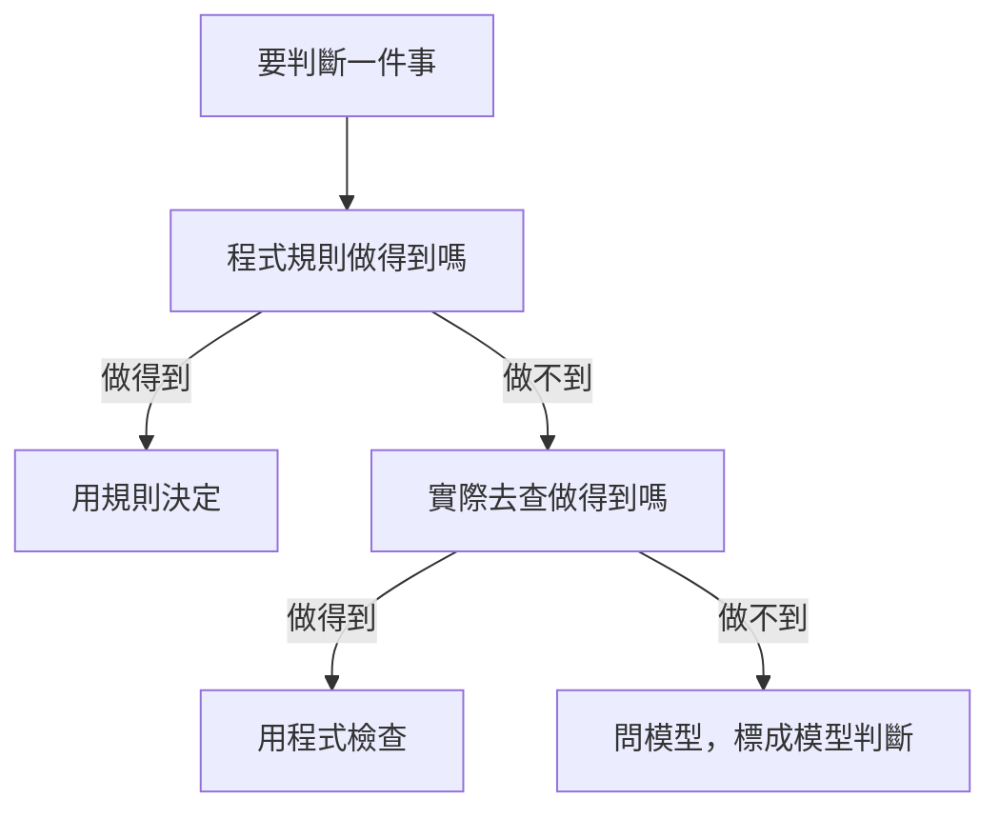

這一頁講 AnyBot 為什麼要這樣設計。適合第一次想搞懂「它跟一般聊天機器人差在哪」的人。

對你的意義：你交代完可以走開。它自己跟進，做完拿出證據。你不用當它的經理。

下面四條是產品最重要的地方。機制大多還是 📝 規劃中，規則有一部分已經寫成可以測試的程式（見各節的狀態）。

## 可以不理他

交代完就可以走開。只有真的需要你的時候，它才來問。

例子：你說「幫我把這份報告整理好，寄給小王之前先給我看」。它去整理。寄出是收不回來的事，所以寄之前才問你一次。等你回答的時候，它先去做別的，不會空轉。

| 你感受到的 | 它要怎麼做到 | 狀態 |
|---|---|---|
| 交代完可以走開 | 只在真的有風險時才問 | 📝 問你的卡片還沒做。哪些動作一定先問，規則已有單元測試 |
| 不用被問一堆小事 | 問題集中一次問，放進交付報告的「需要你決定的事」 | 📝 |
| 等你的時候它不閒著 | 等回答時先去做別的 | 📝 |

## 主動跟進

你不用追問「好了沒」。沒做完它自己接著做。到了約定的時間，它自己回來看。

例子：你說「每週一早上把上週的會議紀錄收成一頁」。到了週一，就算你的電腦關著，伺服器還是會把這件事叫醒，在 [[Bot 的電腦|名詞表]] 上做。做完才通知你。

| 你感受到的 | 它要怎麼做到 | 狀態 |
|---|---|---|
| 不用追問 | 任務有「怎樣算做完」的標準，沒過就自己接著做 | 🚧 完成的判斷規則已有單元測試，還沒接到真的做事 |
| 說了要做就去做 | 到點由伺服器排程叫醒 | 📝 排程還沒做 |
| 電腦關著也照跑 | 例行任務在 Bot 的電腦上跑 | 📝 Bot 的電腦還沒做 |

## 主動證明做對了

你不用自己去檢查。每個動作自動留[[證據|名詞表]]。做完跑一次[[驗收|名詞表]]。

例子：它說「報告已寄給小王」。這句要連到一筆[[證據|名詞表]]：寄給誰、信件編號、什麼時候寄的。連不到，畫面上就標「未驗證」。你一眼就知道哪些可以直接信。

| 你感受到的 | 它要怎麼做到 | 狀態 |
|---|---|---|
| 不用自己檢查 | 程式從工具的實際回傳記證據，模型不能自己補證據 | 📝 留證據的流程還沒做 |
| 知道哪句可以信 | 交付報告每句宣稱連到證據，沒連到就標未驗證 | 🚧 宣稱分級的規則已有單元測試，報告畫面還沒做 |

## 可以信任

敢把事情交給它。沒有證據就老實說沒有。不確定就寫不確定。做錯要能還原。

例子：它說「我已經改好設定了」，可是沒有改設定的紀錄。這句最高只能到「不知道」，不能變成「已驗證」。同一個模型重複說三次，也不算驗證。

安全承諾一條都不能破。誰都關不掉的底線在[[信任與安全]]。

## 能用程式決定的，不交給模型

模型會猜。程式不會。所以任何判斷都照這個順序：先用寫死的規則，再用實際去查的檢查，最後才問模型。問了模型的，結果要標成「模型判斷」。

這張圖在講：同一件事，能查就查，查不到才問模型。

| 事情 | 程式負責 | 模型只做 |
|---|---|---|
| 要不要先問你 | 動作種類先決定。規則壞了就拒絕 | 規則沒涵蓋的才審，並標出來 |
| 證據 | 從工具的實際回傳記：改了哪些檔、指令的結束碼、寄給誰 | 不能新增，也不能改 |
| 驗收 | 重讀檔案、看測試的結束碼、重開頁面 | 查不到時才判斷，並標出來 |
| 什麼時候再來看 | 伺服器到點就叫醒 | 只提議時間 |
| 這一輪在哪台跑 | 程式規則 | 不用模型 |
| 交付報告 | 結構、步驟、證據連結由程式產生 | 只寫摘要文字 |

一般聊天寬鬆一點，只標明顯跟步驟對不上的，免得滿畫面都是「未驗證」。交付報告嚴格：每句宣稱都要連到證據。

這條原則的產品行為是 📝。開發時的同一條（檢查擋下來就要修，不能關掉）已經用工具在擋，見[[開發流程]]。

## 一個 Bot 就是一個完整的同事

每個 [[Bot|名詞表]] 有自己的身分、記憶、技能和決策。換模型不換這個身分。

Bot 和 Bot 之間是轉交工作，像同事把事情交出去。不是好幾個 agent 在旁邊互相聊天。同一個 Bot 開的支線，結果還是回到同一份任務和記憶。

九個模組（執行迴圈、上下文、模型、狀態、記憶、信任、技能、整理、政策）合起來是**一個**同事，不是九個同事。圖在[[整體架構]]。

這是設計原則。執行迴圈和多數模組還是 📝。模型閘道有人正在寫，還沒合進 `dev`（🚧）。見[[進度與路線]]。

## 你越少介入越好

驗收由系統自動做。你不用當審核員。

- 你沒寫「怎樣算做完」時，Bot 開始時自己寫，程式也從做過的動作得到檢查項目。
- 只有聊天、沒有動手的，回覆送到了就算完成。
- 你按讚可有可無。按了只是多一個「你已確認」，不是完成的條件。
- Bot 想把標準放寬時，不跳出來打斷你。提議放進交付報告，你同意才改。
- 「未驗收」只是誠實的標記。不推播，也不要你做事。

少數真的需要你的情況：有一步對外動作（例如寄信）做了沒有、結果不知道。這時才等你按繼續。

完成的判斷規則已有單元測試（🚧）。自動驗收去重讀檔案、重開頁面，還沒做（📝）。

## 想看細節

- 四個性質、判斷順序、任務是一級物件：[spec/04-product-core.md](https://github.com/igs170911/AnyBot/blob/main/spec/04-product-core.md) §1、§2、§3
- 一個 Bot 就是一個 Agent：`spec/09-decisions.md` 的 K93、K94
- 怎樣才算完成、少介入：K100
- 宣稱的等級：K101
