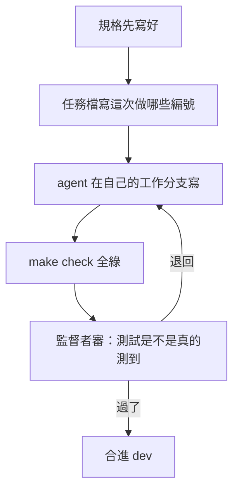
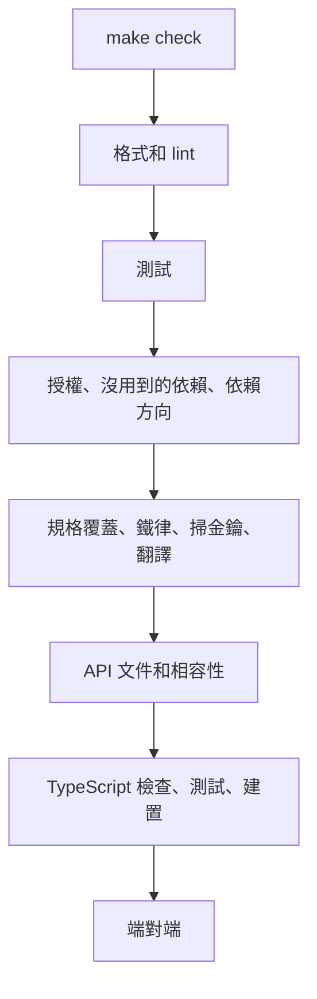

這一頁講這個專案怎麼開發。適合想參與、或想知道「一段程式怎樣才算做完」的人。假設你會基本的 git 和命令列。

對你的意義：規格先寫好。程式照規格寫。檢查沒過就不算完成。人說「應該可以」不算。

## 誰做什麼

規格是唯一的需求來源，在 `spec/`。跟其他文件不一致時，以 `spec/09-decisions.md` 為準。

| 角色 | 做什麼 |
|---|---|
| 規格 | 寫「從外面看應該怎樣」，加上能自動跑的測試清單 |
| 寫程式的 agent | 照規格和任務檔寫程式和測試。不准猜規格沒寫的 |
| 監督者 | 規劃、審核、把過關的合進 `dev`。agent 不准自己 push |

這張圖在講：一個功能從規格到合進 `dev`。

每個功能里程碑要同時有：規格測試、單元／整合／端對端三層、API 文件、五條鐵律，加上 `make check` 全綠。缺一項不算完成。

## 五條鐵律

使用者定的。檢查擋下來的不能關掉，要修到過。

| # | 規則 | 怎麼擋 |
|---|---|---|
| 1 | 不准出現關掉檢查的寫法 | 掃到就擋。例外只有兩條，寫在文件裡 |
| 2 | 每個原始碼檔最多 300 行，每個函式最多 60 行 | 工具擋 |
| 3 | 不寫註解，用名字和型別表達 | 工具擋。產生出來的檔案除外 |
| 4 | 測試名稱帶規格編號，表示那一列的預期都驗完 | 只驗一部分的不准用編號 |
| 5 | 程式碼和測試裡不准有中文 | 給人看的字放翻譯檔。中文只准在翻譯檔、`spec/`、`docs/`、`AGENTS.md` |

金鑰用專用型別：不能印、不能直接序列化。正式程式不准 `unwrap` 這類會直接當掉的寫法。測試裡可以。

測試因為真實的日期變紅，代表程式錯了。不准把測試改成固定時間來讓它變綠。

## make check 有哪些關卡

`make check` 依序跑。任何一步失敗，整次失敗。

這張圖在講：關卡一條條過，不是挑幾條。

| 關卡 | 擋什麼 |
|---|---|
| `cargo fmt` | Rust 格式 |
| `cargo clippy` | Rust lint，包含禁用的寫法：亂讀環境變數、亂執行程式、亂發 HTTP |
| `cargo nextest` | Rust 測試。不要用 `cargo test`，它會讓用同一個埠的測試互搶 |
| `cargo deny` | 授權、已知漏洞、禁用套件 |
| `cargo machete` | 宣告了卻沒用到的依賴 |
| depcheck | 套件依賴方向，見[[專案結構]] |
| spec-trace | 規格測試清單。基準檔只准變短 |
| iron-laws | 五條鐵律、檔案大小、不准關掉檢查 |
| gitleaks | 金鑰，包含 git 歷史 |
| locale | 程式裡的中日韓文字、翻譯檔一致、產生的代碼表是新的 |
| api-docs、api-lint、api-client、api-html | API 文件跟程式一致，而且寫齊說明和範例 |
| api-compat | 破壞性的 API 變更 |
| biome、typecheck、vitest、vite build | TypeScript 格式、型別、測試、建置 |
| e2e | Playwright。手機小螢幕加最大字級、桌面、從右到左、深色、中文和英文 |

改完一批先跑 `make check-fast`。它跑最快的那幾關，包含一組較快的 Rust 測試，跳過較慢的資料庫測試和端對端。

`make test`、`make e2e` 會等別的工作區的測試跑完。這是正常的，不要繞過。

## 測試怎麼寫

規格測試的名字就是規格編號。例如規格的 `T-task-budget-2`，Rust 測試函式叫 `t_task_budget_2`。

名稱帶編號，表示那一列的預期都驗完。只驗了一部分，用描述性的名字，編號留在基準檔。

種類寫「整合」或「端對端」的，要從外面打真的程式（執行檔或 HTTP），不能只呼叫內部函式。

測試裡等外面的東西都要有期限。到期就用 PID 收掉自己啟動的程式。不准用 `pkill`、`killall`。

測試資料需要中文時，用 Unicode 跳脫，不在程式裡寫中文字面。

假模型、假時鐘、假推播、測試用的 PostgreSQL，都在 `tests/harness`。產品套件不能在正式程式裡依賴它。

## 想看細節

- 開發原則：[spec/05-engineering-principles.md](https://github.com/igs170911/AnyBot/blob/main/spec/05-engineering-principles.md) §1、§2、§2a
- 鐵律和測試名稱：`spec/09-decisions.md` 的 K75–K78、K86、K91
- 路線和完成條件：[docs/plan.md](https://github.com/igs170911/AnyBot/blob/main/docs/plan.md)
- 給寫程式的 agent 的規則：[AGENTS.md](https://github.com/igs170911/AnyBot/blob/main/AGENTS.md)
- 測試怎麼跑：[docs/testing.md](https://github.com/igs170911/AnyBot/blob/main/docs/testing.md)
